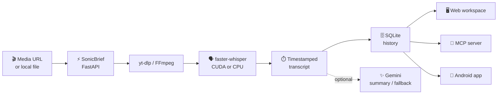
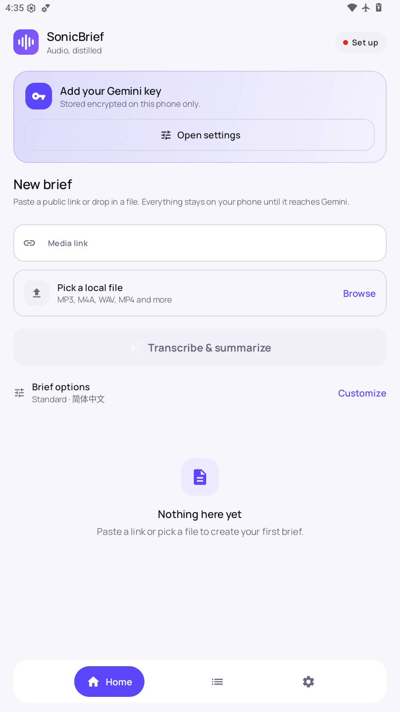
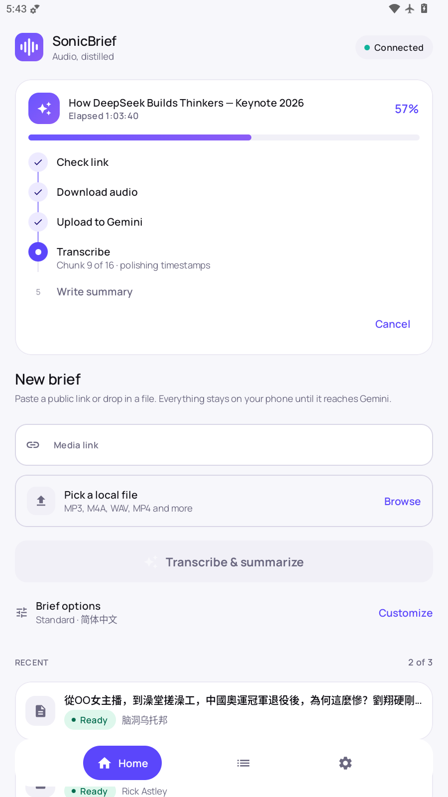
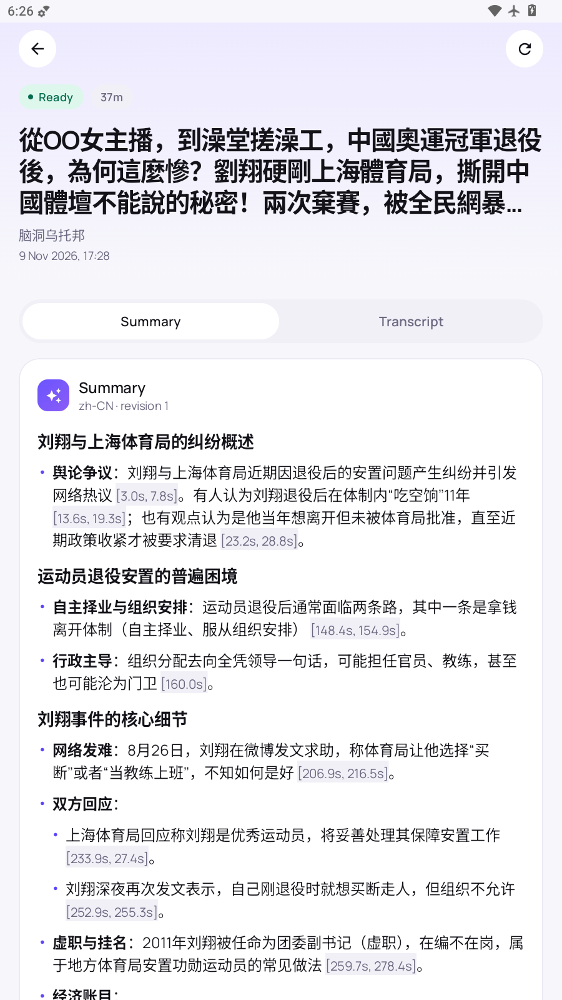

<p align="center">
  
</p>

<h1 align="center">SonicBrief</h1>

<h3 align="center">🎙️ Turn any video or audio into a timestamped transcript and a clean summary.</h3>

**Your media, your machine. Local Whisper keeps the audio on your PC — no upload, no per-minute bill.**

Paste a YouTube, Bilibili, Vimeo, TikTok, X, SoundCloud or Twitch link — or drop in a local file — and SonicBrief returns a timestamped transcript you can search, plus an optional summary. Run it on Windows, on your phone, or from an AI agent over MCP.

<p align="center">
  <strong>Local Whisper</strong> · <strong>Windows app</strong> · <strong>Android APK</strong> · <strong>Chrome extension</strong> · <strong>MCP server</strong>
</p>

<p align="center">
  
  
  
  
  
</p>

<p align="center">
  <strong><a href="#-download">⬇️ Download</a> · <a href="#-quick-start">🚀 Quick start</a> · <a href="#-android-app">📱 Android</a> · <a href="#-faq">❓ FAQ</a></strong>
</p>

<p align="center">
  
</p>

* * *

## Why SonicBrief?

Cloud transcription is convenient until you need an hour of video transcribed every day, or the audio is confidential, or the service changes its pricing.

**SonicBrief runs `faster-whisper` on your own machine.** The audio never leaves the computer, there is no quota, and it keeps working offline once the model is downloaded.

Cloud transcription service | SonicBrief
---|---
Per-minute billing | **Free, unlimited**
Audio uploaded to a vendor | **Stays on your machine**
Needs an account | **No account**
Offline | **Yes, after the model downloads**
GPU acceleration | **Yes — RTX via CUDA, CPU fallback**
Works on Android | **Yes — standalone APK**
Agent access | **Yes — local MCP server**
Price | **$0**

> Local-first by default: MCP transcription uses local Whisper and needs no Gemini key. Cloud fallback and built-in Gemini summaries are opt-in, with your own key.

## ✨ Features

- 🎬 **Almost any public link.** YouTube, Bilibili, Vimeo, TikTok, X/Twitter, SoundCloud, Twitch and more, detected automatically — plus local audio and video files.
- 🎯 **Timestamped local transcription.** `faster-whisper` with Turbo, Large v3, Distil-Large v3 or Small models; RTX GPU detected automatically with CPU fallback.
- 🔍 **Searchable history.** SQLite-backed library with title/creator search, rename and delete.
- 📝 **Summaries that read well.** Markdown summaries with real headings, lists, bold text and inline timestamp chips — not a wall of asterisks.
- 🎨 **Six summary styles.** Brief, Standard, Detailed, Study Notes, Key Points, Meeting notes, plus per-summary custom instructions.
- ⏱️ **Long recordings.** Ranges up to `MAX_MEDIA_HOURS` (12 by default); the Android app splits long audio into 20-minute chunks and merges them back.
- 📤 **Portable exports.** TXT, SRT and JSON from the API; TXT, Markdown, SRT and WebVTT from the Android app.
- 🧩 **One-click from the browser.** The Chrome extension sends the video you are watching straight to the app.
- 📱 **Standalone Android app.** No account, no desktop pairing — transcribe and summarize on the phone with your own Gemini key.
- 🤖 **MCP server for agents.** Submit media over stdio, page through transcripts, let the agent summarize with its own model.
- 🗣️ **Optional speaker labels.** Diarization through `pyannote.audio` when you need "who said what".
- 🚫 **No accounts, no telemetry, no ads.**

## 🧭 How it works



The FastAPI service owns one job queue. The web workspace, the desktop app, the MCP server and the Android app are all clients of the same idea: submit media, get a transcript, keep the history.

## 🚀 Quick start

Pick the shape that fits you.

I want to… | Use this | Needs
---|---|---
Transcribe on my phone | [Android APK](#-android-app) | An Android phone + Gemini key
Install on Windows without Python | [Windows installer](#-windows-desktop-app) | Windows 10/11
Hack on the code | [Local web workspace](#-local-web-workspace-from-source) | Python 3.11, Node 22, FFmpeg
Let an AI agent transcribe | [MCP server](#-mcp-server-for-ai-agents) | Docker (recommended) or Python
Send videos from Chrome | [Chrome extension](#-chrome-extension) | The desktop or local app running

## ⬇️ Download

Platform | File | Requirements
---|---|---
**Android** | `app-universal-release.apk` (or `app-arm64-v8a-release.apk`) | Android 8.0+, your own Gemini key
**Windows** installer, NVIDIA | `SonicBrief-Setup-gpu.exe` + optional `SonicBrief-CudaPack.zip` | Windows 10/11 64-bit
**Windows** installer, any PC | `SonicBrief-Setup-cpu.exe` | Windows 10/11 64-bit
**Chrome extension** | `extension/` folder (Load unpacked) | Chrome / Edge

Grab the files from [**Releases**](https://github.com/nestchao/SonicBrief/releases). Each release publishes SHA-256 checksums (`SHA256SUMS.txt`) next to the binaries.

The Windows installers are not code-signed, so SmartScreen may warn the first time — choose **More info → Run anyway**. Verify the SHA-256 hash if you want certainty.

## 📱 Android app

A standalone APK in `android/` (`applicationId dev.sonicbrief.mobile`). No Supabase, no desktop pairing, no accounts — it transcribes and summarizes on the phone using your own Gemini key.

<table>
  <tr>
    <td align="center"></td>
    <td align="center"></td>
    <td align="center"></td>
  </tr>
  <tr>
    <td align="center"><sub>Capture a link or a file</sub></td>
    <td align="center"><sub>Live five-step progress</sub></td>
    <td align="center"><sub>Summaries rendered as Markdown</sub></td>
  </tr>
</table>

- **Install:** download `app-universal-release.apk`, or the split matching your phone (most modern phones are `arm64-v8a`). Debug builds are `*-debug.apk`; release builds are signed.
- **Setup:** open **Settings → API key**, paste a key from Google AI Studio, and press **Validate & save**. The app lists the models that key can actually use.
- **Use:** paste a YouTube or Bilibili link, pick a local MP3/MP4, or **share a link or file to SonicBrief from any app** — the link lands on Home ready to run.
- **Progress you can read:** every job walks five named steps (check link → download → upload → transcribe → summarize) with a live elapsed clock, shown in the app, on the job card, and in the notification — which also has a **Cancel** action.
- **Long recordings** are split into 20-minute ranges, transcribed in order, and merged back into one transcript.
- **Cookies (optional):** if YouTube asks you to prove you're not a bot, import a `cookies.txt` from a signed-in browser. Only YouTube/Google/Bilibili rows are kept, and they never leave the phone.
- **Self-healing downloader:** the bundled `yt-dlp` refreshes itself when a site changes, then retries the job automatically.
- **Privacy:** the API key is encrypted with the Android Keystore and only ever sent to Google; media goes to Gemini with your key and is then deleted from Google's Files API.
- **License:** `android/` is **GPL-3.0-only** (see [`android/LICENSE`](android/LICENSE)); notices are in [THIRD_PARTY_NOTICES.md](THIRD_PARTY_NOTICES.md#android-app-android-gpl-30-only).

Build it yourself:

```powershell
cd android
./gradlew assembleDebug            # debug APK
powershell -File ../scripts/build_android.ps1   # tests, then signed release if ANDROID_KEYSTORE_* is set
```

## 💻 Windows desktop app

A native Windows app that needs **no Python, Node or `setup.bat`**. It is a small [Tauri](https://tauri.app/) shell (WebView2 window + tray icon) around a bundled server (`SonicBrief-Server.exe`: FastAPI, faster-whisper, yt-dlp, FFmpeg and the web UI). It starts in seconds, keeps running in the tray when you close the window, and stops the server when you quit. It installs per user (no admin rights) and shares data with the portable MCP build in `%LOCALAPPDATA%\SonicBrief` — history in `data\`, Gemini settings in `settings.env`, models in `models\`, logs in `logs\`.

Two installers are built by the **Windows Desktop App** workflow (run it manually or push a `desktop-v<version>` tag):

| Installer | For | Notes |
| --- | --- | --- |
| `SonicBrief-Setup-gpu.exe` | NVIDIA GPUs | Add the **CUDA pack** (below) to transcribe on the GPU; without it this build runs on the CPU. |
| `SonicBrief-Setup-cpu.exe` | Any PC | Smaller; transcription is several times slower. |

**CUDA pack (GPU builds).** The CUDA runtime is about 1.7 GB and the installer format (NSIS) cannot build installers above 2 GiB, so the GPU build keeps those DLLs out and the workflow publishes them separately as `SonicBrief-CudaPack.zip`. If the machine already has a CUDA 12 runtime (a recent NVIDIA driver usually provides one), the pack is unnecessary. Otherwise: quit SonicBrief, unzip the archive so that a `cuda` folder appears at `%LOCALAPPDATA%\SonicBrief\cuda`, then start the app again — the status pill reports GPU mode once the DLLs are found. The server also looks for a `cuda` folder next to the executable. The DLLs are NVIDIA redistributables under the NVIDIA CUDA Toolkit EULA.

Build it yourself on Windows (Rust, Node 22, Python 3.11 with the backend requirements, and FFmpeg on `PATH` are needed):

```powershell
powershell -NoProfile -ExecutionPolicy Bypass -File .\scripts\build_desktop_app.ps1
```

That produces `desktop-app\src-tauri\target\release\bundle\nsis\SonicBrief_*_x64-setup.exe`. A local build uses whatever FFmpeg is on `PATH` and skips the licence checks, so it is for testing only; releases use the audited LGPL FFmpeg from the workflow.

## 🖥️ Local web workspace (from source)

Requirements: Windows 10 or 11, Python 3.11, Node.js 22+, FFmpeg and FFprobe on `PATH`.

Run `setup.bat` once. It creates a Python virtual environment, installs the transcription dependencies and the frontend dependencies, and creates `backend/.env`. Then double-click `start.bat`: it starts the API at `http://127.0.0.1:7860`, the interface at `http://127.0.0.1:3000`, and opens your browser.

On first launch open **Gemini Settings** and paste your own Google AI Studio key. SonicBrief asks Google's Models API which models that key can use, keeps the generation-capable ones, and fills the dropdown dynamically — so the list never goes stale. The key and model are saved to the local `backend/.env`; you never edit it by hand. Prefer a fixed model? Set `GEMINI_MODEL=gemini-flash-lite-latest` in `backend/.env`.

There is also a Python **tray launcher** for development (`SonicBrief.vbs`): it starts the API and interface with no terminal windows, keeps running when you close the tab, adds a tray icon with **Transcribe link from clipboard** and **Start with Windows**, and shows a notification when a transcript is ready. Stop it with the **Stop SonicBrief** shortcut. Logs go to `data\logs\`. The native installer above is the supported way to run it day to day; this launcher stays in the repo so code changes take effect without packaging.

## 🧩 Chrome extension

The `extension/` folder is a Chrome (Manifest V3) extension that sends the video you are watching to your local SonicBrief app.

Install it: open `chrome://extensions`, turn on **Developer mode**, click **Load unpacked**, and choose the `extension` folder. Pin it from the puzzle-piece menu.

- Open the popup on a video page and it shows what it found — e.g. **YouTube** plus the video title — with one button: **Transcribe + summarize**. The link is normalized first, so `youtu.be/ID`, a Short, a live replay, an embed and a `watch?v=` page all resolve to the same video.
- Supported: YouTube, Bilibili, Vimeo, TikTok, X/Twitter, SoundCloud, Twitch, Douyin, Instagram (Reels and posts) and Facebook videos. A supported *host* is not enough: a channel page, the YouTube feed or the Instagram feed shows a "not a video" hint with a paste box instead of a live button.
- **Model** is visible in the popup. **Options** holds the transcript language, the **summary language** (default Simplified Chinese) and the summary style — remembered between popups.
- Right-click a video page or a video link and choose **Transcribe with SonicBrief**, or press **Alt+Shift+S**.
- If SonicBrief isn't running, the extension starts the desktop app through `sonicbrief-desktop://` and sends the link when the app is ready.
- You get a Chrome notification when the transcript is ready; click it to open SonicBrief.

Instagram, Facebook and Douyin often require a signed-in session. If such a job fails with a login or "no video" message, restart the app with cookies from a browser you are signed in to (off by default):

```powershell
$env:SONICBRIEF_YTDLP_COOKIES_FROM_BROWSER = "chrome"   # or edge, firefox
```

The extension only talks to `http://127.0.0.1:7860` and `http://127.0.0.1:3000` on your own computer.

## 🤖 MCP server for AI agents

SonicBrief's MCP mode is **STT-first**: the agent gets a transcript and summarizes it with its own model.

```text
AI agent
  -> SonicBrief MCP over stdio
  -> auto-started local FastAPI backend
  -> yt-dlp / FFmpeg / local faster-whisper
  -> timestamped transcript
  -> agent summarizes with its own model
```

MCP submissions default to **local Whisper only** (`allow_gemini_fallback=false`, `generate_gemini_summary=false`), so no Gemini key is needed. Whisper does **not** run inside the MCP process: the bridge starts or reuses one local FastAPI backend that owns the queue, Whisper work, yt-dlp/FFmpeg and SQLite history, and shuts down the backend it owns when the session ends.

### Recommended: Docker

```powershell
docker build -t sonicbrief-mcp:local .
docker run --rm -v sonicbrief-data:/data sonicbrief-mcp:local --self-test
```

A healthy result reports `"ok": true`, `"ffmpeg_available": true` and `"audio_decode_available": true`. Then point the MCP host at Docker:

```text
command: docker
args: run --rm -i -v sonicbrief-data:/data sonicbrief-mcp:local
```

The `sonicbrief-data` volume persists the SQLite history, the Whisper/Hugging Face model cache and the application cache. To transcribe a local file, mount it read-only (`-v C:\Users\you\Videos:/media:ro`) and pass a container path such as `/media/lecture.mp4`.

The included `compose.yaml` does the same:

```powershell
docker compose build
docker compose run --rm -T sonicbrief-mcp --self-test
```

### NVIDIA GPU image

```powershell
docker build -f Dockerfile.gpu -t sonicbrief-mcp:gpu .
docker run --rm --gpus all -v sonicbrief-data:/data sonicbrief-mcp:gpu --self-test
```

The GPU image uses NVIDIA CUDA 12.8 with cuDNN and runs the same code. The CPU and GPU images share the `sonicbrief-data` volume, so history and models carry over. Compose users can use the GPU profile:

```powershell
docker compose --profile gpu build sonicbrief-mcp-gpu
docker compose --profile gpu run --rm -T sonicbrief-mcp-gpu --self-test
```

### Native install

If SonicBrief is already installed natively, point the MCP host at the virtualenv:

```text
command: C:\path\to\SonicBrief\.venv\Scripts\python.exe
args:    C:\path\to\SonicBrief\sonicbrief_mcp.py
```

You do **not** need to run `start.bat` first — the MCP process checks `127.0.0.1:7860` and starts the backend when needed. Set `SONICBRIEF_AUTO_START_BACKEND=0` only if you manage the backend yourself.

Available tools: `get_health`, `submit_media_url(s)`, `submit_local_file`, `get_job`, `list_jobs`, `search_jobs`, `get_transcript` (paginated), `export_transcript` (`txt`/`srt`/`json`), `get_summary`, `generate_summary_with_gemini`, `cancel_job`, `delete_job`.

> A portable Windows MCP build is in preparation; until the `mcp-v0.1.0` release and the matching npm package exist, use Docker or the native install above.

## 🗣️ Speaker identification

Diarization is optional because its models are large. Install it after the base setup:

```powershell
.\.venv\Scripts\python.exe -m pip install -r backend\requirements-diarization.txt
```

Create a Hugging Face token, accept the model's access terms, and add it to `backend/.env`:

```env
HF_TOKEN=your_hugging_face_token
DIARIZATION_MODEL=pyannote/speaker-diarization-3.1
```

Diarization labels anonymous voices such as `Speaker 1` and `Speaker 2`; it does not determine a real name.

## ⚡ NVIDIA GPU notes

The health check reports whether CTranslate2 can reach CUDA. If it reports CPU mode even though CUDA is installed, the CTranslate2 wheel probably expects a different CUDA runtime version — check its compatibility notes, or stay on CPU until the matching libraries are installed. SonicBrief uses `float16` on CUDA and `int8` on CPU.

## 🔒 Privacy and local data

- The API binds to `127.0.0.1`, so it is not exposed to other computers.
- Each user supplies their own Gemini key; it is stored locally and never returned to the frontend. On Android it is encrypted with the Keystore.
- `backend/.env` is local configuration and must never be committed.
- Temporary downloaded or uploaded audio is deleted after processing.
- Persistent results live in `data/sonicbrief.sqlite3`.
- Local Whisper keeps audio on the machine. If you enable Gemini fallback or summaries, or an agent summarizes with a cloud model, the relevant audio or transcript leaves the machine for that step.

## ❓ FAQ

**Do I need a GPU?**

No. CPU works out of the box, just slower. An RTX card with the CUDA pack is several times faster.

**Do I need a Gemini key?**

Only for cloud fallback, built-in summaries, and the Android app. Local transcription never needs one, including over MCP.

**How long can a recording be?**

Up to `MAX_MEDIA_HOURS` (12 by default). The Android app splits long audio into 20-minute ranges and merges them back.

**Why did a YouTube job fail with a "yt-dlp is older than 90 days" warning?**

YouTube changed something the bundled downloader did not understand. SonicBrief now refreshes its downloader and retries automatically; if it still fails, it tells you to check the connection or import cookies.

**The app can't download a video that plays fine in my browser.**

Instagram, Facebook, Douyin and some YouTube videos need a signed-in session. Import cookies (Android) or restart with `SONICBRIEF_YTDLP_COOKIES_FROM_BROWSER` (Windows). Private, DRM-protected or paid content is out of scope.

**Where are my transcripts stored?**

In SQLite: `data/sonicbrief.sqlite3` on Windows, and the app's private storage on Android. Nothing is uploaded to us — there is no us.

**Can my AI agent use it?**

Yes, over stdio MCP. The agent gets a transcript and summarizes with its own model, so no Gemini key is involved.

## 🛠️ Build from source

**Android**

```bash
git clone https://github.com/nestchao/SonicBrief.git
cd SonicBrief/android
./gradlew assembleDebug                 # debug APKs
./gradlew assembleRelease               # signed release (needs ANDROID_KEYSTORE_* env vars)
./gradlew :app:testDebugUnitTest        # unit tests
```

**Windows desktop app** (Rust, Node 22, Python 3.11, FFmpeg on `PATH`)

```powershell
powershell -NoProfile -ExecutionPolicy Bypass -File .\scripts\build_desktop_app.ps1
```

**Web workspace**

```powershell
npm install
npm run dev -- --host 127.0.0.1 --port 3000 --strictPort   # frontend
Set-Location backend; ..\.venv\Scripts\python.exe app.py    # backend
npm run build                                              # production bundle
```

## 🧱 Technical details

Area | Implementation
---|---
Transcription | `faster-whisper` (CTranslate2); Turbo, Large v3, Distil-Large v3, Small
Acceleration | CUDA `float16` when available, `int8` on CPU, automatic fallback
Media acquisition | `yt-dlp` + FFmpeg; audio-only stream selection and remux
API | FastAPI on `127.0.0.1:7860`, single job queue
Frontend | Vite + TypeScript workspace on `127.0.0.1:3000`
Storage | SQLite (`data/sonicbrief.sqlite3`)
Desktop shell | Tauri + WebView2, tray icon, per-user install
Android | Kotlin, Jetpack Compose Material 3, Hilt, Room, WorkManager; Gemini REST with resumable Files API
Android UI | Custom design system (Manrope type, five-step progress timeline, Markdown summaries)
Agent access | Local stdio MCP bridge that auto-starts/reuses the FastAPI backend
Diarization | Optional `pyannote.audio`

### Main API routes

`GET /api/health` · `GET|POST|DELETE /api/settings/gemini` · `POST /api/settings/gemini/models` · `POST /api/settings/gemini/test` · `GET /api/jobs` · `GET /api/jobs/{id}` · `POST /api/jobs/upload` · `POST /api/jobs/url` · `POST /api/jobs/{id}/summaries` · `GET /api/jobs/{id}/export/{txt|srt|json}` · `DELETE /api/jobs/{id}`

## 🤝 Contributing

Bug reports, ideas and pull requests are welcome. When reporting a problem include your OS, phone model if relevant, and the app's log (`data\logs\` on Windows, logcat on Android).

- 🐛 [Report a bug](https://github.com/nestchao/SonicBrief/issues)
- 💬 [Browse issues](https://github.com/nestchao/SonicBrief/issues)

If SonicBrief saved you an hour, a ⭐ helps other people find it.

## ⚖️ Disclaimer

SonicBrief is for media you are allowed to process — your own recordings, or public content whose terms permit it. Respect copyright and each platform's terms of service. Site availability can change when providers update playback or anti-bot rules; private, login-only or DRM-protected media is not guaranteed to work.

## 📄 License

SonicBrief's own source code is **[MIT](LICENSE)** © 2026 nestchao. The `android/` directory is **GPL-3.0-only** (see [`android/LICENSE`](android/LICENSE)) because it links a GPL-3.0 acquisition runtime.

Third-party dependencies and bundled binaries — including FFmpeg, yt-dlp, Whisper model weights, the youtubedl-android runtime, and the Manrope typeface — retain their own licenses. See [THIRD_PARTY_NOTICES.md](THIRD_PARTY_NOTICES.md) and complete the distribution and source obligations before publishing binaries.
