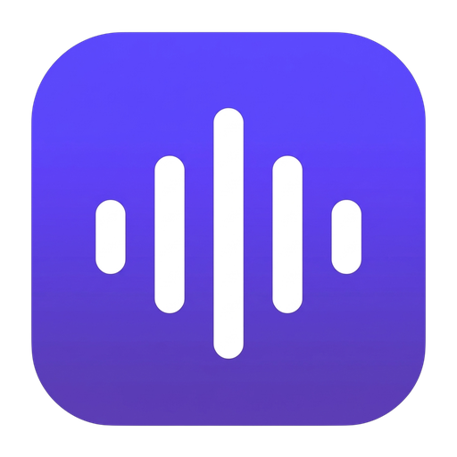
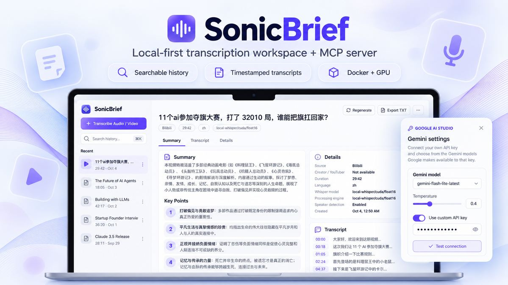
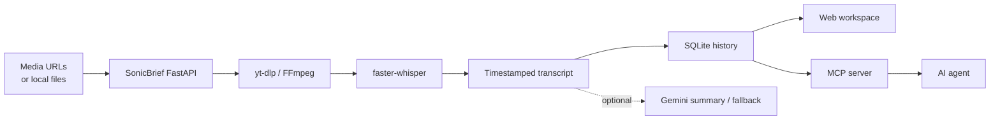

<p align="center">
  
</p>

<h1 align="center">SonicBrief</h1>

<p align="center">
  Local-first media transcription workspace + MCP server powered by faster-whisper.
</p>

<p align="center">
  <strong>Local STT</strong> · <strong>NVIDIA GPU</strong> · <strong>Docker</strong> · <strong>MCP</strong> · <strong>Optional Gemini</strong>
</p>

<p align="center">
  
</p>

<p align="center">
  
</p>

SonicBrief turns public media links and local audio/video files into searchable, timestamped transcripts. It accepts YouTube, Bilibili, Vimeo, TikTok, X/Twitter, SoundCloud, Twitch, and local files. Local `faster-whisper` transcription is the core service; Gemini fallback and built-in summaries are optional. Transcripts, optional summaries, and job history are stored in SQLite.

## Architecture



> **Local-first by default:** MCP transcription uses local Whisper and does not require a Gemini API key. Cloud fallback and built-in Gemini summaries are opt-in.

## What is included

- Public media URLs from YouTube, Bilibili, Vimeo, TikTok, X/Twitter, SoundCloud, and Twitch
- Local `faster-whisper` transcription with timestamps
- Whisper model choices: Turbo, Large v3, Distil-Large v3, and Small
- Media duration limit defaults to 12 hours and can be changed with `MAX_MEDIA_HOURS` in `backend/.env`
- RTX GPU detection with automatic CPU fallback
- Optional Gemini transcription fallback when explicitly requested
- Optional Gemini summaries; MCP agents can instead summarize the transcript with their own model
- Optional speaker diarization through `pyannote.audio`
- Local SQLite history with title/creator search and downloaded-media creator metadata
- Dedicated Summary, Transcript, and Details workspace views
- Full-transcript search and one-click copy
- Markdown-formatted summaries with headings, bold text, lists, quotes, and timestamp chips
- Summary presets: Brief, Standard, Detailed, Study Notes, Key Points, and Custom
- Optional per-summary custom instructions, with Standard remembered as the default preset
- TXT, SRT, and JSON export endpoints
- Temporary media deletion after each task
- Local stdio MCP server for AI agents, backed by the same FastAPI job queue and SQLite history

## Windows setup

Requirements:

- Windows 10 or 11
- Python 3.11
- Node.js 22 or newer
- FFmpeg and FFprobe available in `PATH`

Run `setup.bat` once. It creates a Python virtual environment, installs the base transcription dependencies, installs the frontend dependencies, and creates `backend/.env`.

For URL jobs, SonicBrief detects the supported site automatically and downloads public media through `yt-dlp`. Site availability can change when providers update playback or anti-bot rules; private/login-only media is not guaranteed to work.

Double-click `start.bat`. On first launch, open **Gemini Settings** and paste your own Google AI Studio API key. SonicBrief asks Google's Gemini Models API for the models available to that key, keeps Gemini models that support `generateContent`, filters out specialized transcription, TTS, image, Live/audio, embedding, Omni, custom-tools, robotics, computer-use, and research variants, and fills the model dropdown dynamically. This avoids shipping a short hardcoded model list that can become stale.

The API key and selected model are saved to the local `backend/.env` file on that computer; you do not need to edit the file manually. If you paste a different key, use **Refresh models** before testing or saving so the dropdown reflects that key's access. The dropdown puts the `-latest` aliases first (Flash-Lite Latest, Flash Latest, Pro Latest), then sorts numbered releases from newest to oldest, with stable models ahead of preview/experimental variants for the same version.

You can also configure the shared model in `backend/.env` if needed:

```env
GEMINI_MODEL=gemini-flash-lite-latest
```

Legacy `GEMINI_TRANSCRIPTION_MODEL` and `GEMINI_SUMMARY_MODEL` overrides remain supported for existing installs. The app still performs local transcription without Gemini, but summary generation and cloud fallback require the key.

Then double-click `start.bat`. It starts the API at `http://127.0.0.1:7860`, starts the web interface at `http://127.0.0.1:3000`, and opens the interface in your browser.

## Desktop app (system tray)

For everyday use, launch **SonicBrief** from the Desktop or Start Menu shortcut that `setup.bat` creates (or double-click `SonicBrief.vbs`). It:

- starts the API and web interface in the background, with no terminal windows, and opens SonicBrief in a tab of your normal browser once it is ready (the first start can take a few minutes);
- keeps running in the background when you close the tab, so jobs keep going; launch the **SonicBrief** shortcut again to reopen the tab;
- reuses an API or interface that is already running instead of starting a second copy, and only one desktop app runs at a time;
- adds a system tray icon (when Windows allows it) with **Open SonicBrief**, **Transcribe link from clipboard**, **Start with Windows**, folder shortcuts, and **Quit**, and shows a Windows notification when a transcript is ready or a job fails.

> **The native installer app (next section) is the supported way to run SonicBrief now.** It starts in seconds and its tray icon is reliable. This Python launcher stays in the repository as the development path — it runs the backend and Vite straight from the checkout, so code changes take effect without packaging anything. If both are installed, the Desktop/Start Menu **SonicBrief** shortcut opens the native app; start the dev launcher with `SonicBrief.vbs` when you are working on the code.

**To stop SonicBrief**, use the **Stop SonicBrief** shortcut (or double-click `Stop SonicBrief.bat`). It does not need the tray icon, which some PCs hide or block. It asks the running app to quit, which also stops the API and interface, and it asks first if a transcription is still running.

Logs are written to `data\logs\`. The desktop app also registers a per-user `sonicbrief-desktop://` link so the Chrome extension can start it. To add the shortcuts or packages to an existing install without rerunning setup:

```powershell
.\.venv\Scripts\python.exe -m pip install -r desktop\requirements.txt
powershell -NoProfile -ExecutionPolicy Bypass -File .\desktop\install_shortcuts.ps1
```

## Windows installer app (native)

A native Windows app that needs no Python, Node, or `setup.bat`: install it, open **SonicBrief** from the Start Menu, and transcribe. It is a small [Tauri](https://tauri.app/) shell (WebView2 window + tray) around a bundled server (`SonicBrief-Server.exe`: the FastAPI backend, faster-whisper, yt-dlp, FFmpeg, and the web UI). It starts in seconds, keeps running in the tray when you close the window, and stops the server when you quit. It installs per user (no administrator rights) and shares its data with the portable MCP build in `%LOCALAPPDATA%\SonicBrief` (history in `data\`, Gemini settings in `settings.env`, models in `models\`, logs in `logs\`).

Two installers are built by the **Windows Desktop App** GitHub workflow (run it manually or push a `desktop-v<version>` tag):

| Installer | For | Notes |
| --- | --- | --- |
| `SonicBrief-Setup-gpu.exe` | NVIDIA GPUs | Same installer size as the CPU one. Add the **CUDA pack** (below) to transcribe on the GPU; without it this build runs on the CPU. |
| `SonicBrief-Setup-cpu.exe` | Any PC | Smaller; transcription is several times slower. |

**CUDA pack (GPU builds).** The CUDA runtime is about 1.7 GB and the installer format (NSIS) cannot build installers above 2 GiB, so the GPU build keeps those DLLs out and the workflow publishes them separately as `SonicBrief-CudaPack.zip`. If the machine already has a CUDA 12 runtime (a recent NVIDIA driver usually provides one), the pack is unnecessary. Otherwise: quit SonicBrief, unzip the archive so that a `cuda` folder appears at `%LOCALAPPDATA%\SonicBrief\cuda`, then start the app again — the status pill reports GPU mode once the DLLs are found. The server also looks for a `cuda` folder next to the executable. The DLLs are NVIDIA redistributables under the NVIDIA CUDA Toolkit EULA.

The installers are not code-signed, so Windows SmartScreen shows "Windows protected your PC" the first time: choose **More info → Run anyway**.

Build it yourself on Windows (Rust, Node 22, Python 3.11 with the backend requirements, and FFmpeg on `PATH` are needed):

```powershell
powershell -NoProfile -ExecutionPolicy Bypass -File .\scripts\build_desktop_app.ps1
```

That produces `desktop-app\src-tauri\target\release\bundle\nsis\SonicBrief_*_x64-setup.exe`. A local build uses whatever FFmpeg is on `PATH` and skips the licence checks, so it is for testing only; releases use the audited LGPL FFmpeg from the workflow. The Chrome extension below works with this app unchanged.

## Chrome extension

The `extension/` folder is a Chrome (Manifest V3) extension that sends the video you are watching to your local SonicBrief app.

Install it: open `chrome://extensions`, turn on **Developer mode**, click **Load unpacked**, and choose the `extension` folder. Pin it from the puzzle-piece menu. After editing the extension, press **Reload** on its card.

- Open the popup on a video page and it shows what it found — e.g. **YouTube** plus the video title — with one button: **Transcribe + summarize**. The link is normalized first, so `youtu.be/ID`, a Short, a live replay, an embed and a `watch?v=` page all resolve to the same video.
- Supported: YouTube, Bilibili, Vimeo, TikTok, X/Twitter, SoundCloud, Twitch, Douyin, Instagram (Reels and posts) and Facebook videos. A supported *host* is not enough: a channel page, the YouTube feed, the Instagram feed or the Facebook home page shows a "not a video" hint with a paste box instead of a live button.
- **Model** is visible in the popup (Whisper Turbo, Large v3, Distil Large v3, Small). **Options** holds the transcript language, the **summary language** (default Simplified Chinese) and the summary style. Every choice is remembered between popups.
- Right-click a video page or a video link and choose **Transcribe with SonicBrief**, or press **Alt+Shift+S**.
- If SonicBrief isn't running, the extension starts the desktop app through `sonicbrief-desktop://` (Chrome asks once to allow it) and sends the link when the app is ready.
- You get a Chrome notification when the transcript is ready; click it to open SonicBrief.

Instagram, Facebook and Douyin often require a signed-in session. If such a job fails with a login or "no video" message, restart the app with cookies from a browser you are signed in to (off by default):

```powershell
$env:SONICBRIEF_YTDLP_COOKIES_FROM_BROWSER = "chrome"   # or edge, firefox
```

The extension only talks to `http://127.0.0.1:7860` and `http://127.0.0.1:3000` on your own computer.

## Speaker identification

Speaker diarization is optional because its machine-learning packages are large. Install it after the base setup:

```powershell
.\.venv\Scripts\python.exe -m pip install -r backend\requirements-diarization.txt
```

Create a Hugging Face access token, accept the access terms for the configured pyannote model, and add the token to `backend/.env`:

```env
HF_TOKEN=your_hugging_face_token
DIARIZATION_MODEL=pyannote/speaker-diarization-3.1
```

Speaker diarization identifies anonymous voices such as `Speaker 1` and `Speaker 2`; it does not determine a person's real name.

## NVIDIA GPU notes

The API health check reports whether CTranslate2 can access CUDA. If it reports CPU mode even though NVIDIA CUDA is installed, the CTranslate2 wheel may expect a different CUDA runtime library version. Check the CTranslate2 compatibility notes for the installed version, or use CPU mode until the matching runtime libraries are installed. SonicBrief uses `float16` on CUDA and `int8` on CPU.

## Local data and privacy

- The API binds to `127.0.0.1`, so it is not exposed to other computers.
- Each user supplies their own Gemini API key; it is saved locally in `backend/.env` and is never returned to the frontend.
- `backend/.env` is local configuration and must never be committed to Git.
- Temporary downloaded or uploaded audio is deleted after processing.
- Persistent results are stored in `data/sonicbrief.sqlite3`.
- If Gemini fallback or summaries are enabled, the relevant audio or transcript is sent to Google's API.

## MCP server for AI agents

SonicBrief's MCP mode is **STT-first**. The default agent workflow is:

```text
AI agent
  -> SonicBrief MCP over stdio
  -> auto-started local FastAPI backend
  -> yt-dlp / FFmpeg / local faster-whisper
  -> timestamped transcript
  -> agent summarizes with its own model
```

MCP URL/file submissions default to **local Whisper only**: `allow_gemini_fallback=false` and `generate_gemini_summary=false`. This means a normal MCP transcription does not need a Gemini key. The agent can page through `get_transcript` and summarize the transcript itself.

If the user wants SonicBrief's built-in Gemini summary, configure a Gemini API key and explicitly call `generate_summary_with_gemini`, or submit a job with `generate_gemini_summary=true`. Cloud transcription fallback is also opt-in.

Whisper does **not** run inside the MCP process. The MCP bridge starts/reuses one local FastAPI backend, and that backend owns the processing queue, Whisper CPU/GPU work, yt-dlp/FFmpeg, and SQLite history. If the GUI/backend is already running, MCP reuses it. If it is not running, MCP starts it automatically and shuts down the backend process it owns when the MCP session ends.

### Recommended MCP installation: Docker

For headless agent use, Docker avoids installing Python, FFmpeg, yt-dlp, or the Python packages manually.

Build once:

```powershell
docker build -t sonicbrief-mcp:local .
```

Verify the image and automatic backend startup:

```powershell
docker run --rm -v sonicbrief-data:/data sonicbrief-mcp:local --self-test
```

A healthy result reports `"ok": true`, `"ffmpeg_available": true`, and `"audio_decode_available": true`. This self-test starts the backend automatically, checks it, performs a tiny local faster-whisper/PyAV audio decode to catch dependency incompatibilities, then exits.

Then configure the MCP host to launch Docker:

```text
command: docker
args:
  run
  --rm
  -i
  -v
  sonicbrief-data:/data
  sonicbrief-mcp:local
```

The `sonicbrief-data` volume persists:
- SQLite job/transcript history
- downloaded Whisper/Hugging Face model cache
- application cache

The FastAPI backend stays inside the same container and is not published to the host network. Therefore an MCP health response may show `backend_url: http://127.0.0.1:7860` even though Windows has a different process on host port 7860: inside Docker, that loopback address belongs to the MCP container. `get_health` reports `backend_runtime`, `backend_scope`, `backend_pid`, `backend_instance_id`, `data_dir`, and `database_path` so agents can distinguish the container backend from a native host backend. The first transcription for a Whisper model may take longer while its model files are downloaded; later container runs reuse the model from the Docker volume.

The included `compose.yaml` provides the same persistent setup for users who prefer Compose:

```powershell
docker compose build
docker compose run --rm -T sonicbrief-mcp --self-test
```

No Gemini key is required when the connected AI agent will summarize the transcript. To enable SonicBrief's optional Gemini features in Docker, pass `GEMINI_API_KEY` into the container through your MCP host/environment instead of baking it into the image.

For local files, the container must be able to see the file. Mount a read-only media folder, for example:

```text
-v C:\Users\you\Videos:/media:ro
```

and give `submit_local_file` a container path such as `/media/lecture.mp4`.

### NVIDIA GPU Docker image

The default `Dockerfile` remains the portable CPU image. NVIDIA users can build the dedicated CUDA image:

```powershell
docker build -f Dockerfile.gpu -t sonicbrief-mcp:gpu .
```

The GPU image is based on NVIDIA CUDA 12.8 with cuDNN and runs the same SonicBrief MCP/backend code. Verify GPU passthrough and CTranslate2 detection:

```powershell
docker run --rm --gpus all `
  -v sonicbrief-data:/data `
  sonicbrief-mcp:gpu --self-test
```

A successful GPU setup should report:

```json
{
  "ok": true,
  "backend_started_by_mcp": true,
  "backend_runtime": "docker",
  "data_dir": "/data",
  "database_path": "/data/sonicbrief.sqlite3",
  "ffmpeg_available": true,
  "audio_decode_available": true,
  "cuda_available": true,
  "device": "NVIDIA GPU"
}
```

Then configure an MCP host to launch the GPU image:

```text
command: docker
args:
  run
  --rm
  -i
  --gpus
  all
  -v
  sonicbrief-data:/data
  sonicbrief-mcp:gpu
```

The CPU and GPU images share the same `sonicbrief-data` volume, so job history and downloaded model files persist when switching between them.

Compose users can use the GPU profile:

```powershell
docker compose --profile gpu build sonicbrief-mcp-gpu
docker compose --profile gpu run --rm -T sonicbrief-mcp-gpu --self-test
```

If `nvidia-smi` works inside an NVIDIA CUDA container but SonicBrief still reports `cuda_available: false`, the remaining issue is inside the CUDA/cuDNN/CTranslate2 runtime rather than Docker GPU passthrough.

### Experimental portable Windows MCP (release packaging)

A **Windows x64 CPU-only** distribution is being prepared for users who do
not want Docker, Python, or FFmpeg installed on their PCs. The package will be
delivered through an npm launcher, similar to Chrome DevTools MCP. **Node.js
20.19+ and npm are still required.** Model weights download on first use.

Once an official `mcp-v0.1.0` GitHub Release and the corresponding
`@nestchao/sonicbrief-mcp` npm package have been published, a supported
MCP host can run:

```json
{
  "mcp": {
    "servers": {
      "sonicbrief": {
        "type": "local",
        "command": ["npx", "-y", "@nestchao/sonicbrief-mcp@latest"]
      }
    }
  }
}
```

This **is not available from npm yet**. GitHub's portable build workflow
(`.github/workflows/portable-mcp.yml`) creates the Windows ZIP,
SHA-256 checksums, and an npm tarball with the verified ZIP digest. The tagged workflow creates a **draft GitHub Release** for review; publishing
it and releasing the matching npm tarball are separate manual steps after testing. Do not publish
the checked-in npm folder as-is; its digest is intentionally empty.

On first launch, the npm package fetches the checksum-pinned GitHub Release
under `%LOCALAPPDATA%\SonicBrief\runtime\`. Job history and model caches
are preserved separately in `%LOCALAPPDATA%\SonicBrief\data` and
`%LOCALAPPDATA%\SonicBrief\models`. It launches the local MCP over
stdio and automatically starts/stops FastAPI. The portable CPU package does
not require Docker Desktop, and its local SQLite database is separate from
existing Docker volume data. Optional Gemini features still require users'
own credentials. Compatible NVIDIA GPU runtime packaging is planned after
the Windows CPU workflow is validated.

### Native MCP installation

Docker is optional. If SonicBrief is already installed natively, configure the MCP host with:

```text
command: C:\path\to\SonicBrief\.venv\Scripts\python.exe
args:    C:\path\to\SonicBrief\sonicbrief_mcp.py
```

You do **not** need to run `start.bat` first. The MCP process checks `127.0.0.1:7860` and starts `backend/app.py` automatically when needed. Set `SONICBRIEF_AUTO_START_BACKEND=0` only if you intentionally want to manage the backend yourself.

Available MCP tools include:
- `get_health`
- `submit_media_url` and `submit_media_urls`
- `submit_local_file`
- `get_job`, `list_jobs`, and `search_jobs`
- `get_transcript` with offset/limit pagination
- `export_transcript` for exact `txt`, `srt`, or `json` backend exports
- `get_summary` for an already stored built-in summary
- `generate_summary_with_gemini` for explicit Gemini summarization
- `cancel_job`
- `delete_job`

Long-running transcription remains job-based: submit first, check `get_job`, then retrieve transcript pages when the job completes. The MCP call does not remain open for the entire video.

### Privacy model

Local Whisper keeps STT audio processing on the computer/container. If the connected AI agent summarizes the transcript using a cloud model, the transcript may be sent to that model provider. If Gemini fallback or `generate_summary_with_gemini` is explicitly used, the relevant audio/transcript is sent to Google's API.

## License

SonicBrief's project-owned code is licensed under the [MIT License](LICENSE).
Third-party dependencies and bundled binaries, including FFmpeg, retain their
own licenses and distribution requirements. See [third-party notices](THIRD_PARTY_NOTICES.md)
and complete the distribution/source obligations before public publication.

## Development commands

Frontend:

```powershell
npm run dev -- --host 127.0.0.1 --port 3000 --strictPort
```

Backend:

```powershell
Set-Location backend
..\.venv\Scripts\python.exe app.py
```

Production frontend build:

```powershell
npm run build
```

## Main API routes

- `GET /api/health`
- `GET /api/settings/gemini`
- `POST /api/settings/gemini` (save a local Gemini key and model)
- `POST /api/settings/gemini/models` (load text-focused generation models available to a key)
- `POST /api/settings/gemini/test` (test a key/model without saving it)
- `DELETE /api/settings/gemini` (remove the saved key)
- `GET /api/jobs`
- `GET /api/jobs/{id}`
- `POST /api/jobs/upload`
- `POST /api/jobs/url`
- `POST /api/jobs/{id}/summaries`
- `GET /api/jobs/{id}/export/txt`
- `GET /api/jobs/{id}/export/srt`
- `GET /api/jobs/{id}/export/json`
- `DELETE /api/jobs/{id}`

## License

SonicBrief's original source code is released under the [MIT License](LICENSE)
(Copyright (c) 2026 nestchao). Third-party dependencies, model weights, and
bundled tools such as FFmpeg retain their respective licenses. The portable
Windows release must include applicable third-party license notices and meet
redistribution requirements before general publication.
